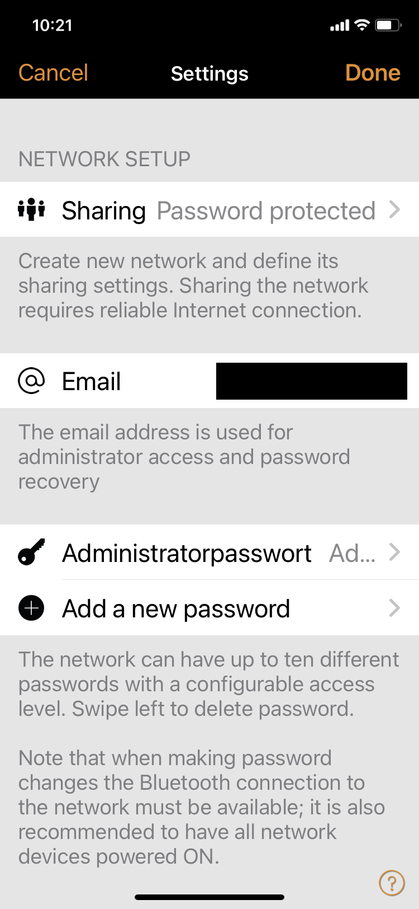
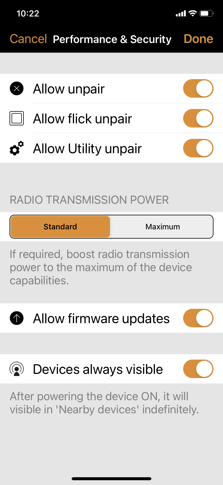

[](https://discord.gg/jgZVugfx)

# A bluetooth based Python library for controlling Casambi networks

This library provides a currently **alpha quality** interface to Casambi-based lights over Bluetooth.
The author is not associated with Casambi and the implementation is based on his own analysis of the protocol.
This interface is not feature complete and was only tested with a very small network.

If you want to check out my (slow) progress in writing a integration for Home Assistant using this library you can take a look at [https://github.com/lkempf/casambi-bt-hass/](https://github.com/lkempf/casambi-bt-hass/).

For a more mature solution using a gateway and the official Casambi API have a look at [https://github.com/hellqvio86/aiocasambi](https://github.com/hellqvio86/aiocasambi).

## Getting started

This library is available on PyPi:

```
pip install casambi-bt
```

Have a look at `demo.py` for a small example.

### MacOS

MacOS [does not expose the Bluetooth MAC address via their official API](https://github.com/hbldh/bleak/issues/140),
if you're running this library on MacOS, it will use an undocumented IOBluetooth API to get the MAC Address.
Without the real MAC address the integration with Casambi will not work.
If you're running into problems fetching the MAC address on MacOS, try it on a Raspberry Pi.

### Casambi network setup

If you have problems connecting to the network please check that your network is configured appropriately before creating an issue. The network I test this with uses the **Evoultion firmware** and is configured as follows (screenshots are for the iOS app but the Android app should look very similar):





## Offline operation

The library only needs the Casambi cloud to download the configuration of a
network (units, groups, scenes and the keys of the network) and the types of
the units. Everything is cached, and the bluetooth connection itself never
needs the cloud.

- `connect(..., preferCache=True)` uses the cached configuration without
  contacting the cloud. Use `refreshNetwork(password)` afterwards to check for
  a newer configuration; it is stored in the cache and used by the next
  connect.
- Without `preferCache` the cloud is asked first. Any cloud error other than a
  rejected password (maintenance, rate limits, no internet) falls back to the
  cache. Unit types are kept beyond their expiry while the cloud is
  unreachable.
- `AuthenticationError.status_code` and `CloudUnavailableError.status_code`
  tell apart a rejected password from an unavailable cloud.

### Offline backup

`exportOfflineBackup()` returns everything needed to use a network without the
cloud as a JSON serializable dict. `importOfflineBackup(backup)` restores it
into the cache of a new installation, so a following connect works without the
cloud.

**The backup contains the keys of your network. Store it like a password**,
e.g. as a file in your password manager.

A restored network keeps working as long as its configuration and keys don't
change. Changes made in the Casambi app need the cloud (or a new backup).
